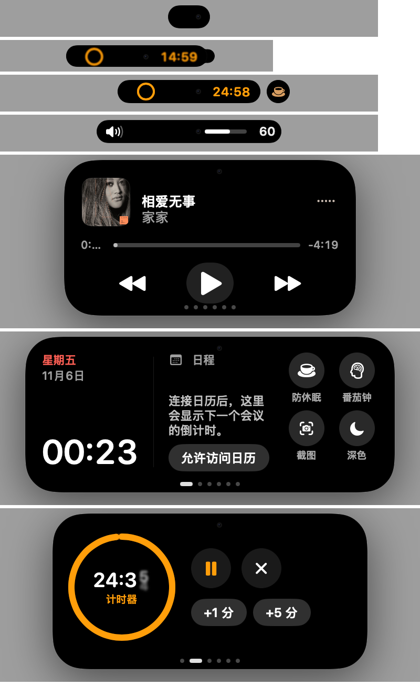

# MacIsle

在任何 Mac 上用上"灵动岛"：一颗悬浮在菜单栏里的小胶囊，平时显示正在进行的事，点开就是一张张实用卡片。专为外接显示器和没有灵动岛的 Mac 设计，也适配带刘海的 MacBook。



## 功能

**外观与动效**
- 按 MacBook Pro（PROLED XDR）灵动岛比例还原：收起时是随菜单栏缩放的小胶囊，展开后是 Apple 尺寸的圆角卡片
- 弹簧动画、液态分裂的第二活动小圆点、跟手的双指翻页，GPU 绘制，空闲时 CPU 约 0%
- 刘海屏自动贴合刘海；外接屏悬浮显示，可选虚拟摄像头圆点

**实时活动**
- **AI 任务**：Claude Code / Codex 运行中、等你确认、完成或出错，一眼可见，点一下跳回终端
- **终端长任务**：超过 20 秒的命令结束时提醒成功 / 失败和用时
- 计时器与番茄钟、防休眠、音乐、充电、音量 / 亮度 HUD

**卡片**
- 音乐、概览（时钟 / 下一个日程 / 快捷开关）、计时、日程、系统监控、剪贴板（JSON / URL / Base64 / 时间戳一键转换）、文件暂存
- **App Store 截图**：拖入截图，一键导出 6.9″ / 6.5″ / iPad 13″ 等商店尺寸（无透明通道）
- **客户资料整理**：拖入资料文件夹 → 本机 OCR → 自动分类（执照、证件、合同、发票…）→ 跨文件比对、标出不一致 → 生成 Word 整理文档；支持打码版导出、与上一版对比、App / 游戏上架材料清单

**智能**
- **猜你想用**：根据前台应用、拖入的内容、正在进行的任务和你的使用习惯，展开时自动翻到最可能用的卡片（习惯只保存在本机）
- 键盘操作：⌘⇧I 打开，← → 切换，数字键跳转，Esc 返回

## 安装

从 [Releases](../../releases) 下载 `MacIsle-x.y.z.dmg`，拖进「应用程序」。

应用未经 Apple 公证，第一次打开请在 Finder 里**右键 › 打开**，或者在终端执行：

```bash
xattr -dr com.apple.quarantine /Applications/MacIsle.app
```

需要 macOS 14 或更高版本。

## 接入 Claude Code / Codex / 终端（可选）

```bash
scripts/connect-workflow.sh
```

脚本会给 `~/.claude/settings.json`、`~/.codex/config.toml`、`~/.zshrc` 各加一个钩子（改动前自动备份，已有的 Codex 通知会保留）。撤销：

```bash
scripts/connect-workflow.sh --undo
```

钩子通过 `open -g "macisle://agent?..."` 通知 MacIsle，不会抢走焦点。

## 从源码构建

需要 Xcode 26 或更高版本。

```bash
scripts/install-local.sh      # 编译并安装到 /Applications
scripts/package-release.sh    # 生成 dist/ 下的 zip 和 dmg
```

## 隐私

- OCR、资料整理、剪贴板、使用习惯全部在本机处理，不联网上传
- 剪贴板历史只存在内存里，密码管理器标记为隐私的内容会自动跳过
- 资料整理的历史对比只记录文件名、大小和关键字段，不保存全文

## 致谢与许可

MacIsle 基于开源项目 [Boring Notch](https://github.com/TheBoredTeam/boring.notch)（© TheBoredTeam，GPL-3.0）修改而来：沿用了它的媒体、电池、日历、文件暂存等底层模块，界面、交互和新功能为重写或新增。

本项目同样以 **GPL-3.0** 协议开源，详见 [LICENSE](LICENSE)；第三方组件的许可见 [THIRD_PARTY_LICENSES](THIRD_PARTY_LICENSES) 与 [NOTICE](NOTICE)。

MacIsle 是独立项目，与 Apple Inc. 没有任何关联。"Dynamic Island"、"MacBook"、"macOS" 是 Apple Inc. 的商标。
