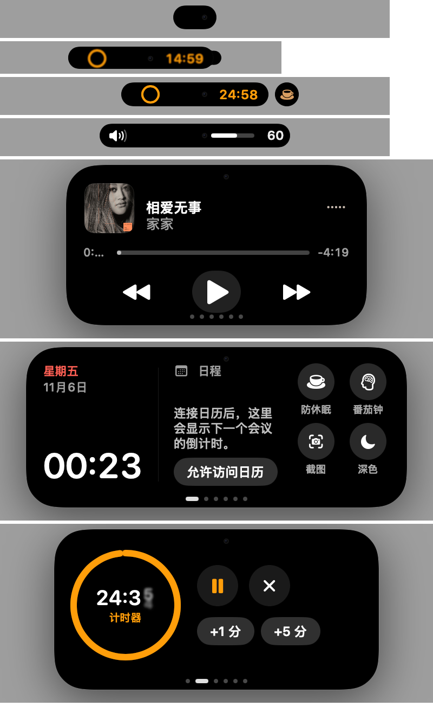

# MacIsle

[English](README.md) | **简体中文**

MacIsle 让任何 Mac 都有一个"灵动岛"：屏幕顶部正中、菜单栏里悬浮着一颗黑色小胶囊。平时它安静地显示正在进行的事（AI 在跑任务、计时器在倒数、音乐在播放）；鼠标停上去或点一下，它会展开成一张卡片，让你不切换窗口就能查看和操作。

适合外接显示器和没有灵动岛的 Mac；在带刘海的 MacBook 上，它会自动贴合刘海。



---

## 怎么用

| 操作 | 效果 |
| --- | --- |
| 鼠标停在岛展开后的区域内（约 0.3 秒，不动） | 展开岛。只是划过去不会触发 |
| 点击小胶囊 | 立即展开 |
| 鼠标移出卡片 | 自动收起 |
| 触控板双指左右滑 / 点底部小圆点 | 切换卡片 |
| ⌘⇧I | 用键盘打开；← → 切换卡片，数字键直接跳转，Esc 关闭并回到原来的应用 |
| 右键岛 | 快捷菜单：设置、防休眠、番茄钟、显示 / 隐藏摄像头圆点 |

岛收起时是一颗小胶囊，有任务进行时会向两侧变宽：左边显示图标，右边显示状态（计时、进度、波形）。如果同时有两件事，第二件会从岛上"分裂"出一个小圆点。

---

## 实时活动（岛收起时显示）

### AI 任务：Claude Code / Codex
**解决什么问题**：同时开几个 AI 编程任务时，不用来回切窗口看它们跑完没有、是不是在等你批准。

- **运行中**：图标转圈，右边显示已运行的时间；同时有多个任务时显示数量角标
- **等你确认**：Claude 请求权限时，岛变成橙色举手图标并提示音；你批准后自动切回"运行中"
- **完成 / 出错**：弹出绿色对勾或红色叉号，显示项目名和用时
- **点击任务直接跳到对应的会话**：
  - Claude 桌面版的会话 → 打开那个会话
  - Codex 桌面版的线程 → 打开那个线程
  - 在「终端」/ iTerm2 里运行的 → 切到它所在的那个标签页
- 被中断、一直没有结束信号的任务，静默 10 分钟后自动清除

需要先运行一次接入脚本，见下文 [接入 Claude Code / Codex / 终端](#接入-claude-code--codex--终端)。

### 终端长任务
运行超过 20 秒的命令（比如 `xcodebuild`、`npm install`、`docker build`）结束时，岛会提示成功还是失败、用了多久，不用一直盯着终端。`vim`、`ssh` 这类交互命令不会提示。

### 计时器与番茄钟
倒计时显示在岛上，结束时提示音并弹出提醒。番茄钟默认专注 25 分钟、休息 5 分钟，自动循环并记录今天完成了几个。

### 其他
- **音乐**：显示封面和跳动的波形；切歌时短暂弹出歌名
- **防休眠**：开启后 Mac 不会自动熄屏或睡眠，适合跑长任务、开会投屏
- **充电提醒**：接上或拔下电源时显示电量
- **音量 / 亮度**：可以用岛代替系统的音量和亮度提示（需要辅助功能权限）

---

## 卡片（岛展开后显示）

卡片尺寸各不相同，切换时岛会平滑变形。展开时会自动翻到你最可能要用的那张（见 [猜你想用](#猜你想用)）。

| 卡片 | 作用 |
| --- | --- |
| **音乐** | 封面、歌名、进度条（可拖动）、上一首 / 播放暂停 / 下一首 |
| **AI 任务** | 所有 AI 任务和终端长任务的列表，点击跳到对应会话；可清除已完成的 |
| **概览** | 星期、日期、时间；下一个日程的倒计时（是线上会议还会有"加入会议"按钮）；四个快捷开关：防休眠、番茄钟、截图（截到剪贴板）、深色模式 |
| **计时** | 番茄钟和 1 / 3 / 5 / 10 / 25 / 60 分钟快速计时；进行中可以暂停、加 1 / 5 分钟、结束 |
| **日程** | 一周日期条和当天的日程、提醒事项 |
| **资料整理** | 客户资料 OCR、分类、比对、生成 Word（见下文） |
| **商店截图** | 把截图转成 App Store 要求的尺寸（见下文） |
| **系统** | CPU、内存、网速（上传 / 下载）及曲线 |
| **剪贴板** | 最近复制过的文字、图片和文件，点一下重新复制；带开发者小工具（见下文） |
| **文件** | 文件暂存区：把文件拖到岛上先放着，之后再拖出去，或者用 AirDrop / 分享发出去 |

不需要的卡片可以在设置里隐藏，也可以用 ↑ ↓ 调整顺序。

### 商店截图
**解决什么问题**：上架 App Store 时，每种设备的截图尺寸都不一样，手动裁剪很麻烦。

把截图拖到卡片上（或点击选择），勾选需要的尺寸（iPhone 6.9″ / 6.5″ / 6.3″ / 5.5″，iPad 13″ / 12.9″），会自动导出到「下载 › App Store 截图」。
- 竖屏、横屏都能处理，按比例填满后居中裁剪
- 输出不带透明通道的 PNG（带透明通道的截图会被商店拒收）

### 剪贴板开发者工具
复制内容后，剪贴板卡片里每条记录旁会出现一键转换按钮，点一下就把结果复制走：
- **JSON**：格式化 / 压缩
- **时间戳**：Unix 时间戳 ↔ 日期
- **URL**：解码
- **Base64**：编码 / 解码
- **JWT**：查看载荷内容
- **命名**：带下划线或空格的标识符转成驼峰命名

剪贴板历史只存在内存里，退出即清空；密码管理器标记为隐私的内容不会被记录。

### 资料整理
**解决什么问题**：客户发来一堆资料（营业执照、身份证、合同、授权书、发票、截图……），要逐份核对信息是否一致、整理成清单，非常耗时。这个功能专为中文资料设计。

把客户资料**文件夹**拖到岛上，它会：

1. **识别**：用 macOS 自带的 OCR 在本机识别图片、扫描件和 PDF，也能直接读取 Word、RTF、TXT
2. **分类**：自动归为营业执照、身份证件、合同协议、授权 / 承诺函、发票、资质证书、银行 / 付款、说明材料、截图等
3. **提取关键信息**：主体名称、统一社会信用代码、法定代表人、联系人、身份证号、手机号、邮箱、地址、App 名称；发票的号码、日期、税额、价税合计、购销双方；合同的金额、签订日期、甲乙方
4. **跨文件比对**：同一项信息在不同文件里写法不一样时，标出来让你点选正确的值（或"按多数"一键采用）。只差一个字的会提示"疑似识别误差"。乙方 / 被授权方、发票上的销售方会归为"合作方"，不会误报冲突
5. **核对上架材料**：按"App 上架"或"游戏上架"检查营业执照、法人身份证、软著、ICP / App 备案、隐私政策（游戏还有版号、防沉迷）是否齐全
6. **和上一版对比**：同一个客户再次提交时，列出新增、删除、改动的文件和变更的信息
7. **生成文档**：在「下载 › 客户资料整理」生成 Word 报告，包括概览、关键信息核对表、差异与待确认事项、发票汇总、分类明细和识别全文
8. **打码版**：生成隐藏身份证号、银行卡号、手机号的报告，并把图片和 PDF 上的这些号码涂黑，方便转发给别人

识别过程中可以收起岛去做别的，进度会显示在岛上，完成后提醒你。

---

## 猜你想用

每次展开时，岛会自动翻到你最可能要用的那张卡片。如果猜的不是默认的"概览"，底部会短暂显示原因（例如"猜你想用 · 你拖来的是一个文件夹"）。

它会参考：
- **正在发生的事**：有 AI 任务在等你确认、计时进行中、正在放音乐、会议 15 分钟内开始、刚复制了能转换的内容、资料正在识别
- **你拖来的东西**：文件夹 → 资料整理；从 Xcode / 模拟器拖来的截图 → 商店截图；其他文件 → 文件暂存
- **前台应用**：终端 / Claude / Codex → AI 任务；Xcode / TestFlight → 商店截图；音乐 / 抖音 → 音乐；微信 / Word → 资料整理、剪贴板
- **你的习惯**：记录你在什么应用、什么时段最后用了哪张卡片，越用越准。只存在本机，可以在设置里清除

不需要的话可以在设置里关掉。

---

## 设置

点菜单栏的 MacIsle 图标 › 设置，或在岛上右键 › 设置。

- **通用**：开机启动、界面语言（跟随系统 / 中文 / English）、显示在哪块屏幕、全屏应用中是否显示、菜单栏图标
- **外观**：胶囊大小、虚拟摄像头圆点、空闲时是否显示小胶囊
- **交互**：悬停展开及延迟、翻页需要滑动的距离、快速轻扫的距离、触感反馈、键盘快捷键
- **卡片**：显示 / 隐藏、用 ↑ ↓ 调整顺序
- **媒体与系统**：音乐信息来源、用岛显示音量 / 亮度、文件暂存
- **智能**：猜你想用、显示猜测原因、清除学到的习惯、剪贴板历史
- **自检**：一键检查 AI 任务通道、OCR、权限、文件夹访问、手势判断和资源占用，有问题会直接列出来

---

## 安装

从 [Releases](../../releases) 下载 `MacIsle-x.y.z.dmg`，拖进「应用程序」。需要 macOS 14 或更高版本。

应用未经 Apple 公证，第一次打开请在访达里**右键 › 打开**，或者在终端执行：

```bash
xattr -dr com.apple.quarantine /Applications/MacIsle.app
```

**可能会请求的权限**（都是用到对应功能时才会问）：
- 日历：概览卡片显示下一个日程
- 自动化（控制「终端」/「系统事件」/ 音乐）：跳到终端标签页、切换深色模式、控制播放
- 辅助功能：用岛代替系统音量 / 亮度提示

## 接入 Claude Code / Codex / 终端

AI 任务和终端长任务提醒需要先接入一次：

```bash
scripts/connect-workflow.sh
```

脚本会：
- 在 `~/.claude/settings.json` 加入钩子（开始、等待确认、工具执行、完成）
- 在 `~/.codex/config.toml` 的 `notify` 里接入 MacIsle，原有的通知命令会保留并继续执行
- 在 `~/.zshrc` 里加一行，用来统计长命令（新开的终端窗口才会生效）

每个文件改动前都会自动备份。撤销：

```bash
scripts/connect-workflow.sh --undo
```

钩子通过 `open -g "macisle://agent?..."` 通知 MacIsle，不会抢走焦点。

## 从源码构建

需要 Xcode 26 或更高版本。

```bash
scripts/install-local.sh      # 编译并安装到 /Applications
scripts/package-release.sh    # 生成 dist/ 下的 zip 和 dmg
```

## 隐私

- OCR、资料整理、剪贴板、使用习惯全部在本机处理，不联网上传
- 剪贴板历史只存在内存里
- 资料整理的历史对比只记录文件名、大小和关键字段，不保存全文

## 致谢与许可

MacIsle 基于开源项目 [Boring Notch](https://github.com/TheBoredTeam/boring.notch)（© TheBoredTeam，GPL-3.0）修改而来：沿用了它的媒体、电池、日历、文件暂存等底层模块，界面、交互和新功能为重写或新增。

本项目同样以 **GPL-3.0** 协议开源，详见 [LICENSE](LICENSE)；第三方组件的许可见 [THIRD_PARTY_LICENSES](THIRD_PARTY_LICENSES) 与 [NOTICE](NOTICE)。

MacIsle 是独立项目，与 Apple Inc. 没有任何关联。"Dynamic Island"、"MacBook"、"macOS" 是 Apple Inc. 的商标。
